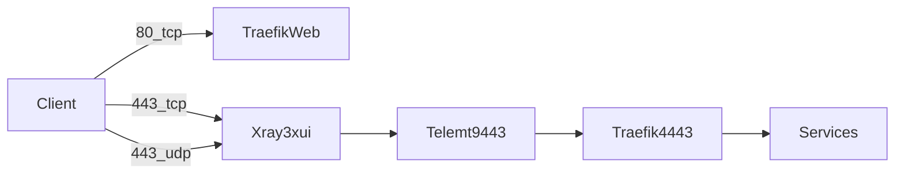
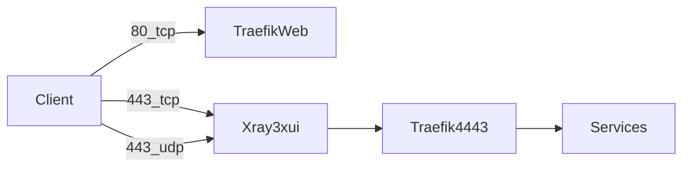

# 3x-ui_pro_Docker

[](https://deepwiki.com/Torotin/3x-ui_pro_Docker)
[](https://deepwiki.com/Torotin/3x-ui_pro_Docker)

`3x-ui_pro_Docker` — Docker Compose стек и installer CLI/wizard для развёртывания прокси-инфраструктуры на чистом Debian/Ubuntu: Traefik, 3x-ui/Xray, AdGuard Home, CrowdSec, Caddy, Homepage, Dozzle, usque (WARP), TOR helper и опциональные Telemt / Lampac / Mihomo.

Репозиторий содержит compose-фрагменты, installer, шаблоны окружения и mock-only тесты. Собственные образы проекта собираются в [AutoDockerBuilder](https://github.com/Torotin/AutoDockerBuilder).

Версия installer: см. [`script/VERSION`](script/VERSION). Журнал изменений — [`script/CHANGELOG.md`](script/CHANGELOG.md) (может отставать от VERSION; ориентир по номеру — файл VERSION).

## Содержание

1. [Поддерживаемая платформа](#поддерживаемая-платформа)
2. [Границы каталогов](#границы-каталогов)
3. [Подготовка перед установкой](#подготовка-перед-установкой)
4. [Быстрый старт — wizard](#быстрый-старт--wizard)
5. [Быстрый старт — batch](#быстрый-старт--batch)
6. [Процедура: шаги 0–9 и confirm matrix](#процедура-шаги-09-и-confirm-matrix)
7. [Переменные, SSH_PBK, feature toggles](#переменные-ssh_pbk-feature-toggles)
8. [Публичные порты и маршрутизация](#публичные-порты-и-маршрутизация)
9. [Команды installer](#команды-installer)
10. [Doctor](#doctor)
11. [Self-update](#self-update)
12. [Что разворачивается](#что-разворачивается)
13. [Безопасность / destructive flags](#безопасность--destructive-flags)
14. [После установки](#после-установки)
15. [Troubleshooting](#troubleshooting)
16. [Удаление](#удаление)
17. [Файлы состояния](#файлы-состояния)
18. [Локальная разработка и проверки](#локальная-разработка-и-проверки)
19. [Серверная проверка](#серверная-проверка)

## Поддерживаемая платформа

- Debian / Ubuntu.
- `systemd` и `apt`.
- Docker Engine с Compose plugin.
- Root/sudo для пакетов, Docker, firewall, SSH и sysctl.
- Локальная разработка installer — только mock/fake окружение (без реальных apt/docker/ufw на рабочей машине).

## Границы каталогов

| Путь | Назначение |
|------|------------|
| Клон репо + [`script/install.sh`](script/install.sh) | Installer, модули, шаблоны; живёт в репозитории |
| `INSTALL_ROOT` | Корень Docker-стека; default `/opt/docker-proxy`; любой абсолютный путь (пример `/srv/docker-proxy`) |
| `INSTALL_STATE_DIR` | Default `$SCRIPT_DIR/install-state` (рядом со [`script/`](script/), **не** внутри `INSTALL_ROOT`, если не переопределён) |
| `$INSTALL_ROOT/compose.d/.env` | Compose env после шага `env` |

При экспорте `INSTALL_ROOT`, toggles или credentials всегда используйте `sudo -E`. Обычный `sudo` на Debian/Ubuntu сбрасывает env — installer уйдёт в default `/opt/docker-proxy`.

Не путать layout clone-установки с примером `/opt/script` из ops-skill: при установке из git clone installer остаётся в репозитории.

## Подготовка перед установкой

1. Чистый Debian/Ubuntu и root/sudo.
2. DNS A (и AAAA при IPv6) на `WEBDOMAIN` → публичный IP сервера.
3. Свободны host `80/tcp` и `443/tcp`. Host `443/udp` будет открыт firewall и опубликован compose (см. раздел портов).
4. Не публиковать наружу `4443`, `9118`, panel/metrics/CrowdSec ports.
5. Держать второй SSH-сеанс до завершения шагов `firewall` / `ssh`.
6. Решить feature toggles до `compose` (wizard `t` или env exports).

## Быстрый старт — wizard

Рекомендуемый путь для интерактивной установки:

```bash
cd /srv
git clone https://github.com/Torotin/3x-ui_pro_Docker.git
cd 3x-ui_pro_Docker
export INSTALL_ROOT=/srv/docker-proxy   # необязательно; default /opt/docker-proxy
sudo -E script/install.sh doctor
sudo -E script/install.sh wizard
sudo -E script/install.sh doctor
```

Если экспортированы `INSTALL_ROOT`, toggles или credentials — всегда `sudo -E`. Без `-E` env сбрасывается, и installer использует `/opt/docker-proxy`.

Поведение wizard:

- При старте: проверка self-update; предложение обновиться только если remote версия новее.
- Запрос обязательных: `WEBDOMAIN`, `USER_SSH`, `PASS_SSH`, `USER_WEB`, `PASS_WEB`; опционально `SSH_PBK`.
- Меню `0–9` + `t` (toggles) + `x` (exit).
- Рекомендуемый порядок: `0 → 1 → 2 → t → 3 → 4 → 5 → 6 → 7 → 8 → 9`.
- После изменения toggles: в подменю нажать `a` (apply = re-run `env`) **до** `compose`.

## Быстрый старт — batch

Неинтерактивный прогон с явными toggles. Порядок шагов важен: `dnscrypt` до `apt`.

```bash
set -e
cd /srv
git clone https://github.com/Torotin/3x-ui_pro_Docker.git
cd 3x-ui_pro_Docker
chmod +x script/install.sh

export INSTALL_ROOT=/srv/docker-proxy
export WEBDOMAIN=example.com
export USER_SSH=deployer
export PASS_SSH='change-me'
export USER_WEB=admin
export PASS_WEB='change-me'
export PORT_REMOTE_SSH=22022
# Optional: public key. If set → pubkey-only; if unset → password auth.
# export SSH_PBK='ssh-ed25519 ...'

export ENABLE_LAMPAC=false
export ENABLE_TELEMT=false
export ENABLE_MIHOMO=false
export ENABLE_HYSTERIA2=true
export ENABLE_VLESS_GRPC=false

sudo -E script/install.sh doctor
sudo -E script/install.sh run dnscrypt --apply --yes
sudo -E script/install.sh run apt --apply --yes
sudo -E script/install.sh run env
sudo -E script/install.sh run docker --destroy-docker-data
sudo -E script/install.sh run user
sudo -E script/install.sh run firewall ssh network --apply --yes
sudo -E script/install.sh run compose
sudo -E script/install.sh run final
sudo -E script/install.sh doctor
```

`PORT_REMOTE_SSH` в batch задаётся явно; в wizard / `env` может генерироваться случайный порт в диапазоне 20000–65000.

## Процедура: шаги 0–9 и confirm matrix

| Код | Шаг | Назначение | Wizard confirm | Opt-in флаги |
|-----|-----|------------|----------------|--------------|
| 0 | dnscrypt | Host DNS → DNSCrypt/DoH `127.0.0.1:53` | `[y/N]` | `--apply --yes`; pin `--version` / `DNSCRYPT_VERSION`; `--force` / `--reconfigure` |
| 1 | apt | Зеркало + пакеты + unattended-upgrades | `[y/N]` | `--apply --yes` |
| 2 | env | `install.env` + compose `.env`, секреты, порты, fallback hosts ([`02_env.sh`](script/modules/02_env.sh)) | нет | — |
| 3 | docker | Установка Docker; wipe при флаге | `[y/N]` текст про destroy+reinstall | `--destroy-docker-data` |
| 4 | user | Системный `USER_SSH` | нет | — |
| 5 | firewall | UFW политика проекта | `[y/N]` | `--apply --yes` |
| 6 | ssh | sshd port/auth | `[y/N]` | `--apply --yes` |
| 7 | network | sysctl | `[y/N]` | `--apply --yes` |
| 8 | compose | sync → validate → up | нет | — |
| 9 | final | `install.summary` без паролей/ключей ([шаблон](script/template/install.summary.template)) | нет | — |
| t | toggles | `ENABLE_*` | подменю 1–5, `a`, `x` | `a` = save + re-run `env` |

Confirm есть **только** у: `dnscrypt`, `apt`, `docker`, `firewall`, `ssh`, `network`.  
Confirm **нет** у: `env`, `user`, `compose`, `final`, toggles.

## Переменные, SSH_PBK, feature toggles

### Обязательные и типичные переменные

- `WEBDOMAIN` — публичный домен.
- `USER_SSH` / `PASS_SSH` — системный пользователь для SSH.
- `USER_WEB` / `PASS_WEB` — BasicAuth для web-панелей.
- `SSH_PBK` — публичный SSH-ключ (необязательно).
- `PORT_REMOTE_SSH` — порт sshd (в batch задайте явно; иначе random 20000–65000).
- `INSTALL_ROOT` / `INSTALL_STATE_DIR` — см. [Границы каталогов](#границы-каталогов).

Остальное (URI панелей, CrowdSec keys, htpasswd, AdGuard hash, публичные IP) генерируется шагом `env`.

### SSH_PBK и режимы auth

- `SSH_PBK` задан → `PUBKEY_AUTH=yes`, `PASSWORD_AUTH=no` (только ключ).
- `SSH_PBK` пуст → `PUBKEY_AUTH=no`, `PASSWORD_AUTH=yes` (пароль).
- Не закрывайте старый SSH-сеанс, пока новый вход на `PORT_REMOTE_SSH` не проверен.
- Endpoint после установки — в `install.summary` (`SUMMARY_SSH_TARGET`; [шаблон](script/template/install.summary.template)). Конкретный host/port/user в README не фиксируются.

### Feature toggles

Defaults на fresh install:

| Переменная | Default | Эффект |
|------------|---------|--------|
| `ENABLE_LAMPAC` | `false` | Compose fragment [`14-lampac.yml`](docker-proxy/compose.d/14-lampac.yml) |
| `ENABLE_TELEMT` | `false` | Compose fragment [`15-telemt.yml`](docker-proxy/compose.d/15-telemt.yml) + Vision/REALITY fallback |
| `ENABLE_MIHOMO` | `false` | Compose fragment [`16-mihomo.yml`](docker-proxy/compose.d/16-mihomo.yml) |
| `ENABLE_HYSTERIA2` | `true` | Hysteria2 inbound в Xray desired state (**не** host publish/UFW) |
| `ENABLE_VLESS_GRPC` | `false` | VLESS gRPC inbound в Xray (не отдельный compose-сервис) |

Wizard submenu (`t`):

- `1` Lampac, `2` Telemt, `3` Hysteria2, `4` VLESS gRPC, `5` Mihomo
- `a` — apply/render env; `x` — назад

Поведение off-path (оба target: Vision **и** REALITY):

- `ENABLE_TELEMT=false`: [`run-compose.sh`](docker-proxy/compose.d/run-compose.sh) исключает [`15-telemt.yml`](docker-proxy/compose.d/15-telemt.yml); telemt toml не рендерится; `VISION_FALLBACK_HOST=traefik`, `VISION_FALLBACK_PORT=4443`; `REALITY_TARGET_HOST=traefik`, `REALITY_TARGET_PORT=4443`. Orphan `telemt-panel` — только при миграции со старой split-установки.
- `ENABLE_TELEMT=true`: Vision **и** REALITY → `telemt:${PORT_LOCAL_TELEMT_PROXY:-9443}` (`VISION_FALLBACK_*` + `REALITY_TARGET_*`); Telemt mask → Traefik `:4443`; один контейнер `telemt`; образ `TELEMT_STACK_IMAGE` (default `torotin/telemt-stack:latest`).
- `ENABLE_LAMPAC=false` / `ENABLE_MIHOMO=false`: fragments [`14-lampac.yml`](docker-proxy/compose.d/14-lampac.yml) / [`16-mihomo.yml`](docker-proxy/compose.d/16-mihomo.yml) не включаются; при Lampac off публичный browser fallback — **Caddy**, не Lampac.

## Публичные порты и маршрутизация

Факты из live compose ([`06-traefik.yml`](docker-proxy/compose.d/06-traefik.yml), [`12-3x-ui.yml`](docker-proxy/compose.d/12-3x-ui.yml)) и firewall ([`06_firewall.sh`](script/modules/06_firewall.sh)):

- Traefik host publish: **только** `80:80` (ACME HTTP-01 + redirect). `websecure` слушает `:4443` внутри Docker network — **не** publish на хост.
- 3x-ui host publish: `443/tcp` (Vision/REALITY) и `443/udp` (mapping **всегда** в [`12-3x-ui.yml`](docker-proxy/compose.d/12-3x-ui.yml)).
- Firewall: всегда `ufw allow` для `80/tcp`, `443/tcp`, `443/udp`.
- `ENABLE_HYSTERIA2` включает inbound в Xray desired state; **не** убирает host `443/udp` mapping и UFW.
- Не открывать наружу: `4443`, `9118`, panel ports, metrics, CrowdSec.
- Traefik HTTP/3 entrypoints в clean install отключены / high-risk — не включать без отдельного плана отката.
- Админки: path-routes на `https://${WEBDOMAIN}/...` + BasicAuth + CrowdSec + rate-limit + noindex.
- Lampac routing (root front без BasicAuth; sensitive `/admin` / `/adminpanel` / `/stats` / `/weblog` — admin middleware) — **только при** `ENABLE_LAMPAC=true`.
- `ENABLE_VLESS_GRPC`: inbound-only toggle (default false); не compose-сервис.

### ASCII — ENABLE_TELEMT=true

```text
client --80/tcp----------> Traefik:80          (ACME / redirect)
client --443/tcp---------> Xray(3x-ui)
                              |
                              v
                           telemt:9443
                              |
                              v
                           Traefik:4443 (websecure, Docker-internal)
                              |
                              v
                           path-routed services
                           (panels + Caddy fallback;
                            Lampac only if ENABLE_LAMPAC=true)

client --443/udp---------> Xray Hysteria2 inbound
                           (host map+UFW always; inbound if ENABLE_HYSTERIA2=true)
```

### ASCII — ENABLE_TELEMT=false

```text
client --80/tcp----------> Traefik:80
client --443/tcp---------> Xray(3x-ui) --> Traefik:4443 --> path-routed services
                           (Caddy fallback; Lampac if ENABLE_LAMPAC=true; нет hop Telemt)
client --443/udp---------> Xray Hysteria2 (как выше)
```

### Mermaid — ENABLE_TELEMT=true

`443/tcp` и `443/udp` — один контейнер `3x-ui` (узел `Xray3xui`).



### Mermaid — ENABLE_TELEMT=false



## Команды installer

```bash
script/install.sh doctor [host|stack] [--verbose] [--strict]
script/install.sh wizard
script/install.sh run <step...> [--destroy-docker-data] [--apply] [--yes]
script/install.sh self-update [--branch <branch>] [--check] [--yes] [--force]
script/install.sh uninstall [--plan|--apply --yes]
```

Доступные шаги:

```text
dnscrypt apt env docker user firewall ssh network compose final uninstall
```

Назначение:

- `doctor` / `doctor host` / `doctor stack` — read-only диагностика.
- `wizard` — интерактивная установка (numbered menu).
- `run` — batch-запуск шагов.
- `self-update` — обновление installer из git-ветки по версии.
- `uninstall` — план или выполнение проекта.

## Doctor

`doctor` не меняет окружение. Запускайте до и после установки.

```bash
sudo -E script/install.sh doctor              # full: preflight + host + stack
sudo -E script/install.sh doctor host         # только host/preflight
sudo -E script/install.sh doctor stack        # только stack
sudo -E script/install.sh doctor --verbose    # детальные OK-строки
sudo -E script/install.sh doctor --strict     # любой WARN → exit 1
```

Профили:

- `doctor` (full) — preflight + host + stack.
- `doctor host` — только host/preflight; stack SKIP.
- `doctor stack` — только stack; host-шаги SKIP.

Exit и footer:

- **FAIL** → ненулевой exit, footer `doctor: FAILED`.
- **WARN** → exit 0 и footer `doctor: WARN` без `--strict`; с `--strict` → exit 1 и `doctor: FAILED`.
- Без WARN/FAIL → exit 0, footer `doctor: OK`.

Отчёт: header (`profile` / `phase`), matrix `STEP STATUS SUMMARY NEXT`, next-actions, footer. `run doctor` — алиас полного `doctor`.

## Self-update

```bash
sudo -E script/install.sh self-update --branch main --check
sudo -E script/install.sh self-update --branch main --yes
```

Текущий номер — [`script/VERSION`](script/VERSION) (авторитетный источник). Описание изменений — [`script/CHANGELOG.md`](script/CHANGELOG.md) (может отставать от VERSION).

- `--check` — сравнить local с remote в выбранной ветке.
- Remote новее → диапазон `local -> remote` и changelog для версий выше текущей.
- Не новее → `self-update: up to date`.
- `--yes` — применить только если remote новее.
- `--force` — применить даже при равной/меньшей remote версии.
- Wizard при старте предлагает update только если remote newer.

## Что разворачивается

### Always-on (clean install, не за toggle)

- Traefik + traefik-acme-exporter
- 3x-ui (+ sub-json-processor)
- AdGuard Home
- CrowdSec + crowdsec-firewall-bouncer
- Caddy (public browser fallback, когда Lampac выключен)
- Homepage, Dozzle
- usque, tor-proxy, logrotate

Compose fragments: [`docker-proxy/compose.d`](docker-proxy/compose.d). Host paths относительно каталога `compose.d`.

### Toggle-gated (default off — не обязательны)

| Сервис | Toggle | Default |
|--------|--------|---------|
| Telemt | `ENABLE_TELEMT` | `false` |
| Lampac | `ENABLE_LAMPAC` | `false` (при off front = Caddy) |
| Mihomo | `ENABLE_MIHOMO` | `false` |

Hysteria2 inbound: default **on** (`ENABLE_HYSTERIA2=true`). Host `443/udp` mapping + UFW — **всегда**, независимо от toggle.

Telemt / Lampac / Mihomo **не** входят в обязательный HTTPS path на clean install. URL Telemt/Mihomo в `install.summary` ([шаблон](script/template/install.summary.template)) помечаются `disabled`, если соответствующий toggle выключен.

## Безопасность / destructive flags

Host-mutating действия требуют явного opt-in:

- DNSCrypt: `run dnscrypt --apply --yes` (рекомендуется до `apt`). Pin: `--version` / `DNSCRYPT_VERSION`; также `--force` / `--reconfigure`.
- APT: `run apt --apply --yes`.
- Docker wipe/reinstall: `run docker --destroy-docker-data`.
- Firewall: `run firewall --apply --yes`.
- SSH: `run ssh --apply --yes`.
- Network/sysctl: `run network --apply --yes`.
- Uninstall purge: отдельные `--purge-*` (см. [Удаление](#удаление)).

SSH apply логирует auth mode, пользователя, порт, backup, `sshd -t`, reload/restart и listening port. Сначала `systemctl reload`; restart — только если reload не поднял новый порт.

Не печатайте в тикеты/логи пароли, htpasswd, CrowdSec keys и private keys.

## После установки

1. Прочитать `$INSTALL_STATE_DIR/install.summary` (default рядом со [`script/`](script/); [шаблон](script/template/install.summary.template)).
2. `sudo -E script/install.sh doctor` / `doctor --verbose`.
3. Открыть URL из summary (`SUMMARY_URL_*`). URL Telemt/Mihomo = `disabled`, если toggle off.
4. [`run-compose.sh`](docker-proxy/compose.d/run-compose.sh) из `$INSTALL_ROOT/compose.d/`: `ps` / `validate` / `logs`.

## Troubleshooting

Формат: симптом → проверка → действие.

1. **APT «File has unexpected size» / mid-sync mirror**  
   Проверка: лог шага `apt`.  
   Действие: повтор `sudo -E script/install.sh run apt --apply --yes` (installer fallback mirror).

2. **Потеря SSH после firewall/ssh**  
   Проверка: второй сеанс; порт и auth из `install.summary` (`SUMMARY_SSH_TARGET`, `SUMMARY_SSH_AUTH`).  
   Действие: если был `SSH_PBK` — только ключ; если пуст — пароль. Не закрывать старый сеанс до проверки нового входа.

3. **doctor WARN vs FAIL / `--strict`**  
   Проверка: footer `doctor: OK|WARN|FAILED`.  
   Действие: FAIL всегда nonzero; WARN → exit 0 без `--strict`; для CI — `doctor --strict`.

4. **Контейнеры unhealthy**  
   Проверка: `doctor stack`; `$INSTALL_ROOT/compose.d/run-compose.sh ps|logs`.  
   Действие: цепочка бэкенды → traefik healthy → traefik-acme-exporter.

5. **ACME / сертификат**  
   Проверка: DNS A/AAAA на `WEBDOMAIN`; host `80/tcp` свободен; логи Traefik.  
   Действие: исправить DNS/порт 80, перезапустить Traefik после фикса.

6. **Админки 404/401**  
   Проверка: path из summary (`SUMMARY_URL_*`); BasicAuth `USER_WEB`/`PASS_WEB`.  
   Действие: открыть точный URL из summary; проверить credentials из `install.env` (не из summary — пароли там не пишутся).

7. **Orphan telemt-panel после миграции**  
   Проверка: старый split-контейнер `telemt-panel` ещё в `docker ps`.  
   Действие: `$INSTALL_ROOT/compose.d/run-compose.sh down --remove-orphans`, затем `up` (только если раньше был split panel).

8. **Host DNS не через DNSCrypt**  
   Проверка: `doctor` DNSCrypt checks; `resolv.conf` / listening `127.0.0.1:53`.  
   Действие: `sudo -E script/install.sh run dnscrypt --apply --yes`.

9. **Локальные тесты трогают host**  
   Проверка: вызовы реальных apt/docker/ufw/systemctl.  
   Действие: только mock ([`tests/install-scripts/run.sh`](tests/install-scripts/run.sh)); не писать в `/etc`/`/opt`/`/var/lib`.

10. **`443/udp` открыт, Hysteria клиенты не работают**  
    Проверка: `ENABLE_HYSTERIA2` в `$INSTALL_ROOT/compose.d/.env`. Publish/UFW ≠ inbound.  
    Действие: выставить `ENABLE_HYSTERIA2=true`, `run env`, затем `run compose`.

11. **Telemt off, но telemt ещё крутится / неверный fallback**  
    Проверка: `ENABLE_TELEMT=false` в compose `.env`; ожидать `VISION_FALLBACK_HOST=traefik` **и** `REALITY_TARGET_HOST=traefik` (ports `4443`); fragment [`15-telemt.yml`](docker-proxy/compose.d/15-telemt.yml) не должен включаться.  
    Действие: `run env`, compose up; при необходимости `down --remove-orphans`.

12. **Неверный INSTALL_ROOT / пустой state**  
    Проверка: те же `INSTALL_ROOT` / `INSTALL_STATE_DIR`, что при установке.  
    Действие: `export` тех же путей и всегда `sudo -E`.

## Удаление

План без изменений:

```bash
sudo -E script/install.sh uninstall --plan
```

Остановка compose stack:

```bash
sudo -E script/install.sh uninstall --apply --yes
```

Полная очистка (все флаги opt-in):

```bash
sudo -E script/install.sh uninstall --apply --yes \
  --purge-docker-data \
  --purge-docker-engine \
  --purge-firewall \
  --purge-ssh \
  --purge-network \
  --purge-dnscrypt \
  --remove-project-root
```

Флаги:

- `--purge-docker-data` — volumes/images проекта и свободные внешние сети.
- `--purge-docker-engine` — Docker packages и `/var/lib/docker`, `/var/lib/containerd`.
- `--purge-firewall` — известные UFW-правила проекта (без глобального `ufw reset`).
- `--purge-ssh` — восстановление backup `sshd_config`, проверка и reload/restart.
- `--purge-network` — восстановление или удаление installer sysctl файла.
- `--purge-dnscrypt` — удаление host DNSCrypt и возврат публичного DNS в `resolv.conf` (по умолчанию DNSCrypt не трогается).
- `--remove-project-root` — удаление `INSTALL_ROOT`.

## Файлы состояния

- `$INSTALL_STATE_DIR/install.env` — состояние installer (default: `script/install-state/`, каталог runtime, в git не хранится).
- `$INSTALL_ROOT/compose.d/.env` — окружение Compose ([`compose.d`](docker-proxy/compose.d)).
- `$INSTALL_STATE_DIR/install.summary` — финальное резюме (без паролей/ключей); шаблон: [`install.summary.template`](script/template/install.summary.template).
- `$INSTALL_STATE_DIR/commands.log` — команды через runner.
- `$INSTALL_STATE_DIR/install.log` — лог installer.

Нестандартное размещение:

```bash
export INSTALL_ROOT=/srv/docker-proxy
export INSTALL_STATE_DIR=/srv/3x-ui-installer-state
sudo -E script/install.sh doctor
```

## Локальная разработка и проверки

Installer локально — только mock/fake. Входные точки: [`tests/install-scripts/run.sh`](tests/install-scripts/run.sh), [`script/install.sh`](script/install.sh), модули [`script/modules/`](script/modules/), checks [`script/check/`](script/check/).

```bash
bash tests/install-scripts/run.sh
bash -n script/install.sh script/modules/*.sh script/check/*.sh
shellcheck -x -S warning script/install.sh script/modules/*.sh script/check/*.sh
```

Compose runner: [`test_run_compose.bash`](tests/run-compose/test_run_compose.bash), [`test_compose_startup_chain.bash`](tests/run-compose/test_compose_startup_chain.bash).

```bash
bash tests/run-compose/test_run_compose.bash
bash tests/run-compose/test_compose_startup_chain.bash
```

3x-ui runtime: [`tests/3x-ui-scripts/run.sh`](tests/3x-ui-scripts/run.sh).

```bash
bash tests/3x-ui-scripts/run.sh
```

Whitespace:

```bash
git diff --check
```

Локальные тесты не должны вызывать реальные `apt`, `docker`, `ufw`, `iptables`, `systemctl`, `sshd`, `modprobe`, `sysctl -p`, `useradd`, `chpasswd` и не должны писать в `/etc`, `/opt`, `/var/lib`.

## Серверная проверка

Минимум после установки:

```bash
sudo -E script/install.sh doctor
sudo -E "$INSTALL_ROOT/compose.d/run-compose.sh" validate
sudo -E "$INSTALL_ROOT/compose.d/run-compose.sh" up
sudo -E script/install.sh run final
```

Конкретный SSH endpoint тестового сервера в README не фиксируется: он передаётся только на время серверной приёмки.
